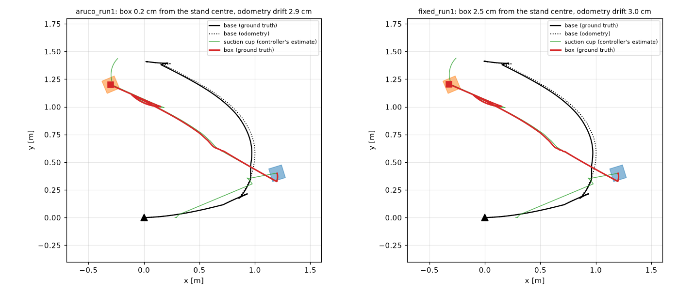
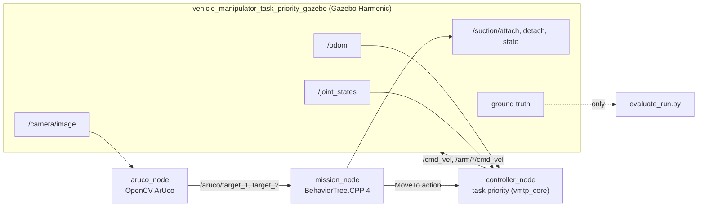

# Task-Priority Control of a Mobile Manipulator (ROS 2)

Pick, transport and place with a differential-drive base carrying a uArm Swift Pro. Base and arm are controlled as
**one kinematic system** by recursive task-priority redundancy resolution — joint limits first, the goal below — so a
goal out of the arm's reach makes the base drive, without a separate navigation stack. A behaviour tree sequences the
mission, and ArUco markers locate the box and the place stand. C++ for **ROS 2 Jazzy** and **Gazebo Harmonic** on
Ubuntu 24.04.



## Result

Four headless runs of the whole mission in Gazebo, each recorded against ground truth by
[`evaluate_run.py`](vehicle_manipulator_task_priority/scripts/evaluate_run.py). The CSV logs are in
[`docs/results/`](docs/results); `python3 tools/plot_run.py docs/results/*.csv out.png` recomputes the numbers and
the figure.

| run | localisation of the targets | mission | duration (sim) | box centre from the place-stand centre | odometry drift at the end |
|---|---|---|---|---|---|
| [ArUco 1](docs/results/aruco_run1.csv) | marker on the box and on the stand, measured on arrival | succeeded | 50.8 s | **0.17 cm** | 2.9 cm |
| [ArUco 2](docs/results/aruco_run2.csv) | 〃 | succeeded | 50.4 s | **0.15 cm** | 2.9 cm |
| [ArUco 3](docs/results/aruco_run3.csv) | 〃 | succeeded | 51.9 s | **0.17 cm** | 2.9 cm |
| [fixed](docs/results/fixed_run1.csv) | known positions, dead reckoning only | succeeded | 49.7 s | 2.5 cm | 3.0 cm |

In every run the box ends upright (tilt 0.0°) and resting on the stand. The base drives 3.0 m; its wheel odometry
drifts by about 3 cm. With fixed positions that drift ends up in the placement; with ArUco it cancels, because each
target is measured in the odometry frame on arrival — the frame the controller itself works in. The three ArUco runs
differ only through simulation timing: the controller and the tree are deterministic, so they are repeats, not
independent trials.

## How it works



**Controller.** The robot state is `q = (x, y, ψ, t1..t4)` and the commands are `u = (ω, v, ṫ1..ṫ4)`: the base's
turn rate and forward speed (a unicycle cannot move sideways), then the four arm joints. Each step (50 Hz) solves

1. joint limits of t1..t4 — set-based tasks, active only within 0.05 rad of a limit, released 0.09 rad away;
2. the goal — suction-cup position, cup position and yaw, arm posture, or base heading;

with the weighted damped least-squares recursion of
[learn-manipulator-control](https://github.com/Rudip1/learn-manipulator-control) (chapters 7–9; pinned commit),
weights 2 on the base inputs and 1 on the arm joints, damping 0.05, and every command scaled down uniformly to at
most 0.3 rad/s or m/s. The mobile-manipulator Jacobian has a column per command; the turn-rate column includes the
lever arm from the base to the cup, so turning the base swings the arm with it. The uArm's kinematics (its
parallelogram keeps the cup level) are in [`swift_pro.hpp`](vehicle_manipulator_task_priority/include/vehicle_manipulator_task_priority/swift_pro.hpp).

**Mission.** [`config/pick_place.xml`](vehicle_manipulator_task_priority/config/pick_place.xml): drive the cup to
within 25 cm of the rough box position, turn the base to face it, wait for ten fresh detections of marker 1, go 6 cm
above the box top, touch it (4 mm tolerance), switch the suction on, lift, tuck the arm; then the same approach to the
place stand (marker 2), set the box down, release, retreat, park. A failed approach is retried once.

**Detector.** Each marker is on a side face of an upright object; the detector moves from the marker pose (OpenCV
`estimatePoseSingleMarkers`, 5 cm markers) horizontally to the object's axis and up to its top face, transforms it to
the odometry frame at the image time, and publishes the median of the last 15 detections.

## Packages

| package | contents |
|---|---|
| [`vehicle_manipulator_task_priority`](vehicle_manipulator_task_priority) | ROS-free core `vmtp_core` (uArm kinematics, mobile-manipulator model, controller), `controller_node`, `aruco_node`, `mission_node`, the behaviour tree, parameters, launch, `evaluate_run.py`, tests |
| [`vehicle_manipulator_task_priority_interfaces`](vehicle_manipulator_task_priority_interfaces) | the `MoveTo` action |
| [`vehicle_manipulator_task_priority_gazebo`](vehicle_manipulator_task_priority_gazebo) | robot (URDF/xacro), world with the box and the two stands, ArUco textures, ros_gz bridge, simulation launch |

The robot is a Kobuki-size base (wheel radius 3.5 cm, track 23 cm) with a deck at 0.198 m carrying the uArm 5.1 cm
ahead of the base centre, a forward camera (640 × 480, 60°) and a suction cup, modelled as a fixed joint that Gazebo
creates and removes on demand. The uArm's parallelogram is a serial chain whose `wrist_level` joint keeps the cup
level; the controller converts between the two joint sets.

## Build

Ubuntu 24.04, ROS 2 Jazzy, Gazebo Harmonic (`ros-jazzy-ros-gz`), BehaviorTree.CPP (`ros-jazzy-behaviortree-cpp`),
OpenCV with the ArUco module (`libopencv-contrib-dev`).

```bash
mkdir -p ~/vmtp_ws/src && cd ~/vmtp_ws/src
git clone https://github.com/Rudip1/vehicle-manipulator-task-priority.git
cd ~/vmtp_ws
rosdep install --from-paths src --ignore-src -y
source /opt/ros/jazzy/setup.bash
colcon build --cmake-args -DCMAKE_BUILD_TYPE=Release
source install/setup.bash
```

The first build downloads learn-manipulator-control (pinned commit). Offline, point CMake at a local checkout:
`colcon build --cmake-args -DFETCHCONTENT_SOURCE_DIR_LEARN_MANIPULATOR_CONTROL=/path/to/learn-manipulator-control`.

## Run

```bash
# Gazebo window, the controller, the detector and the mission
ros2 launch vehicle_manipulator_task_priority pick_place.launch.py

# Without the camera: fixed target positions (dead reckoning)
ros2 launch vehicle_manipulator_task_priority pick_place.launch.py use_aruco:=false

# The recorded experiment: headless, evaluated against ground truth (second terminal for the recorder)
ros2 launch vehicle_manipulator_task_priority pick_place.launch.py gui:=false
ros2 run vehicle_manipulator_task_priority evaluate_run.py --csv run.csv
python3 src/vehicle-manipulator-task-priority/tools/plot_run.py run.csv run.png
```

Parameters are in [`config/controller.yaml`](vehicle_manipulator_task_priority/config/controller.yaml). Single goals
can be sent by hand, e.g.
`ros2 action send_goal /move_to vehicle_manipulator_task_priority_interfaces/action/MoveTo "{type: 0, position: {x: 0.6, y: 0.2, z: 0.25}}"`.

## Tests

```bash
colcon test --packages-select vehicle_manipulator_task_priority && colcon test-result --verbose
```

No simulator needed: the uArm pose at a hand-worked configuration; its Jacobian and the mobile manipulator's
(every frame, every command) against finite differences of the integrated motion; the robot description's serial
chain against the uArm kinematics; and the controller on the kinematic model — posture goals move only the arm,
heading goals only turn the base, near and far cup goals are reached inside the joint limits, and a whole pick-and-place
sequence completes.

## Limitations

- Simulation only. The suction cup is an ideal fixed joint, the box always sticks.
- The targets are located once, on arrival; a box pushed during the approach would be missed.
- Odometry is the only base localisation: it is good over a few metres, and the markers correct it where it matters.
- The base and the stands do not appear in the controller: nothing keeps the base from touching a stand if a goal
  asked for it (the goals in the tree do not).
- The original ROS 1 version (Python, TurtleBot 2 with the uArm in Stonefish, py_trees) is kept at tag
  [`ros1-noetic`](https://github.com/Rudip1/vehicle-manipulator-task-priority/tree/ros1-noetic); its reports are in
  [`docs/`](docs): the [project report](docs/vehicle_manipulator_task_priority_report.pdf) and the
  [kinematics report](docs/report_kinematics_Pravin.pdf).

## Citation

If you use this work, please cite it using [`CITATION.cff`](CITATION.cff).

## Licence

Code released under the [Apache License 2.0](LICENSE). The robot meshes come from other projects; their sources and
licences are listed in
[`meshes/ATTRIBUTION.md`](vehicle_manipulator_task_priority_gazebo/meshes/ATTRIBUTION.md).

## Acknowledgements

- **Gebrecherkos Gebrezgabhier** and **Pravin Oli** designed and implemented the original ROS 1 system together.
- Kobuki meshes by Yujin Robot; uArm Swift Pro meshes by UFACTORY.
- Built on [ROS 2](https://www.ros.org/), [Gazebo](https://gazebosim.org/),
  [BehaviorTree.CPP](https://www.behaviortree.dev/), [OpenCV](https://opencv.org/) and
  [learn-manipulator-control](https://github.com/Rudip1/learn-manipulator-control).
